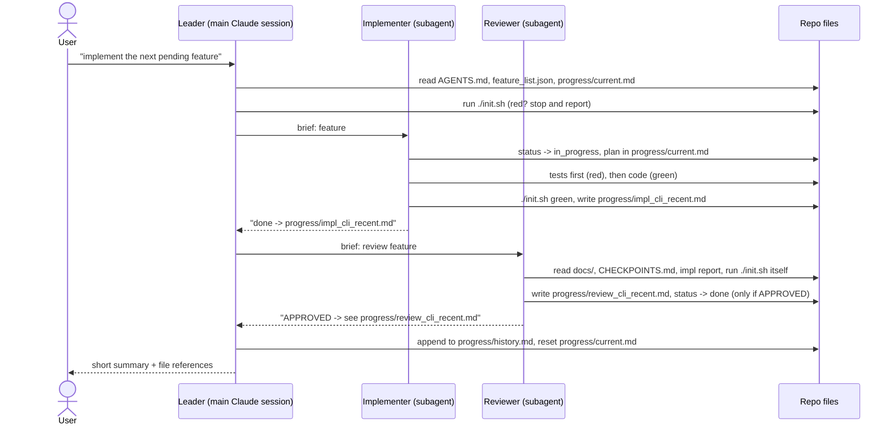

# Harness Engineering: what a harness is, what it is for, and how to build one

> Implementation guide for the C# harness in this repository.
> Based on the video *"Harness Engineering"* (transcript in `Harness-YoutubeVideo-Transcript.txt`, Spanish)
> and its example repository [betta-tech/ejemplo-harness-subagentes](https://github.com/betta-tech/ejemplo-harness-subagentes) (Python),
> which this repo ports to C# / .NET 10.

---

## Contents

1. [TL;DR](#1-tldr)
2. [The problem a harness solves](#2-the-problem-a-harness-solves)
3. [What a harness is](#3-what-a-harness-is)
4. [Why "more" makes a harness worse](#4-why-more-makes-a-harness-worse)
5. [The building blocks](#5-the-building-blocks)
6. [The three pillars](#6-the-three-pillars)
7. [Anatomy of this repository](#7-anatomy-of-this-repository)
8. [How a session flows](#8-how-a-session-flows)
9. [How to build your own harness, step by step](#9-how-to-build-your-own-harness-step-by-step)
10. [Try it: implement feature 7 with the harness](#10-try-it-implement-feature-7-with-the-harness)
11. [Extending the harness](#11-extending-the-harness)
12. [Pitfalls](#12-pitfalls)
13. [Glossary](#13-glossary)
14. [Sources](#14-sources)

---

## 1. TL;DR

- A **harness** is everything you put **around** an AI model so its work is controlled,
  repeatable and verifiable: the **context** it reads, the **tools** it may use, the
  **memory** it keeps outside its context window, and the **verification** that proves
  its work is correct.
- The name comes from horse tack: the model is a powerful horse that can produce thousands
  of lines of code. The harness is the reins and saddle.
- **Harness Engineering** means building that environment **inside your repository**, as
  plain files (Markdown, JSON, scripts), versioned with the code, so every agent and every
  teammate works under the same rules.
- Counter-intuitively, **simpler is better**: fewer, more generic tools and less context
  beat big toolboxes and giant prompts.
- The model becomes a **swappable brain**: when a better or cheaper model ships, you swap
  it and keep the harness.

In this repo the harness is: `AGENTS.md` (map) + `docs/` (rules) + `feature_list.json`
(tasks) + `progress/` (memory) + `init.ps1` (the gate) + `.claude/agents/` (roles) +
`CHECKPOINTS.md` and hooks (verification).

---

## 2. The problem a harness solves

The video starts from three observations:

1. **Writing code is no longer the hard part.** Agents generate code faster than humans
   can read it. The bottleneck moved from *writing* to *controlling and verifying*.
2. **AI output is plausible, not necessarily correct.** Models are trained to produce
   answers that *look* right. AI-generated code can be 100% convincing and still miss
   the goal in small, hard-to-spot places.
3. **Long sessions degrade.** The longer an agent works in one conversation, the more its
   context window fills up, and quality drops well before the window is full. The video
   cites a GitHub discussion where degradation starts at around 20% context usage and a
   reset is recommended at around 40%.

So you cannot just say "build me the app" and let an agent run for hours. You need a
system that **feeds the model the right context, keeps memory outside the model, and
forces it to prove its work**. That system is the harness.

---

## 3. What a harness is

```
                 +------------------------------------------------+
                 |                    HARNESS                     |
                 |                                                |
   CONTEXT  ---> |   AGENTS.md, docs/, CLAUDE.md                  |
                 |   (what the model reads, on demand)            |
                 |                                                |
   TOOLS    ---> |   shell, dotnet CLI, grep/read/edit, init.ps1  |
                 |   (what the model can do; few and generic)     |
                 |                 +-----------+                  |
                 |                 |   MODEL   |  <- swappable    |
                 |                 |  (brain)  |     brain        |
                 |                 +-----------+                  |
   MEMORY   ---> |   feature_list.json, progress/*.md             |
                 |   (state that lives outside the context window)|
                 |                                                |
   VERIFY   ---> |   init.ps1, tests, reviewer agent, hooks,      |
                 |   CHECKPOINTS.md (proof, not claims)           |
                 +------------------------------------------------+
```

Two layers are worth distinguishing:

| Layer | Who builds it | Examples |
|-------|---------------|----------|
| **Agent runtime harness** | Tool vendors | Claude Code, GitHub Copilot agent, Cursor, Codex: the loop that calls the model, runs tools, manages the context window, launches subagents, runs hooks. |
| **Project harness** (what Harness Engineering is about) | **You**, in your repo | `AGENTS.md`, rules in `docs/`, the task list, the memory folder, the init/verification script, agent role definitions, hook scripts. |

You rarely change the first layer. You fully own the second one, and because it is just
files in the repo, it is **portable** (most agent tools read `AGENTS.md`), **reviewable**
(it goes through pull requests like code) and **improvable** (when an agent misbehaves,
you fix the prompt or rule that let it happen).

**What it is used for:**

- Letting an agent work **autonomously on one task at a time** without drifting.
- Making AI work **verifiable**: "done" means a script went green, not that the model said so.
- **Sharing state** between sessions, agents and humans (a new session reads `progress/`
  instead of re-reading the whole codebase).
- **Running several agents** (leader, implementer, reviewer) without losing information
  between them.
- Keeping **quality and conventions** consistent no matter which model or person does the work.

---

## 4. Why "more" makes a harness worse

The tempting idea is: give the model every tool, every MCP server, every skill, a huge
prompt with every rule. The video argues the opposite, with two pieces of evidence:

**Fewer, simpler tools.** It cites a Vercel article about their data-analysis agent
(*d0*). They first gave it many hyper-specialized tools (SQL helpers, database
connectors, wrappers that dictated how to reason). Then they removed most of them (about
80%) and left basic Unix-style tools (`grep`, `cat`, `ls`). Per the video, the simpler
agent was **more than 3x faster, used 37% fewer tokens, and beat the old one on every
request**.

**Less context.** Every rule, file and tool description you load consumes the context
window, and quality degrades long before it is full.

What this means in practice:

| Instead of... | Do this | In this repo |
|---------------|---------|--------------|
| One giant rules file loaded every time | A short **map** that points to rules, read on demand (progressive disclosure) | `AGENTS.md` (70 lines) points to `docs/*.md` |
| Custom tools for every action | The generic tools the agent already has + one verification script | Shell + `dotnet` + `init.ps1` |
| Keeping everything in the chat | Writing state to files | `progress/`, `feature_list.json` |
| One agent that reads everything | Subagents that start with a **clean, small context** for one job | `implementer`, `reviewer`, explorers |

---

## 5. The building blocks

### 5.1 Context: what the model reads

- **Entry point.** `AGENTS.md` is the first thing every agent reads. It is a **map**,
  not a bible: what each file contains and *when* to read it. Agents only load
  `docs/architecture.md` when they are about to implement, `docs/verification.md` when
  they are about to close, and so on.
- **Rules as documents.** `docs/architecture.md` defines what "good work" means (layers,
  no dependencies, immutability, atomic writes). `docs/conventions.md` defines style.
  `docs/verification.md` defines how to prove things. *"If it is not written here, it is
  not a requirement."* The reviewer checks code against these files.
- **Tool-specific overlay.** `CLAUDE.md` is loaded automatically by Claude Code; here it
  only adds "you are the leader". Other tools (Copilot, Codex, Cursor) read `AGENTS.md`.
- **Context hygiene.** The `guide/` folder (this document) is explicitly marked in
  `AGENTS.md` as *do not read*: it would only fill the context window.

### 5.2 Tools: what the model can do

Deliberately minimal: the agent's built-in file/shell tools, the `dotnet` CLI, and
**one** project script, `init.ps1`, which answers a single question: *is the project in
a good enough state to work on?* Subagent definitions restrict tools per role (the
reviewer has no business editing code; the leader does not need to).

### 5.3 Memory: state outside the context window

| File | What it remembers | Lifetime |
|------|-------------------|----------|
| `feature_list.json` | The backlog: each feature with acceptance criteria and status `pending` / `in_progress` / `done` / `blocked` | Whole project |
| `progress/current.md` | The live plan and log of the current session; "next step" if interrupted | One session, then reset |
| `progress/history.md` | Append-only changelog of every closed session | Whole project |
| `progress/explore_*.md`, `impl_*.md`, `review_*.md` | Subagent reports | Until no longer useful |

The JSON task list follows Anthropic's advice for long-running agents: structured, so
agents can pick the next task and several agents can see each other's status. A new
session (or a new agent) reads these files instead of re-reading the project. The video
stresses this is **not magic**: it is just files. You could move it to SQLite or a shared
database later without changing the idea.

### 5.4 Verification: proof, not claims

The most important block. Never let the agent be the one who says something is done.

| Mechanism | What it checks | Who runs it |
|-----------|----------------|-------------|
| `init.ps1` | Environment, harness files, task list validity (max 1 `in_progress`), architecture rules (no NuGet deps in the app, no extra layers, no `Console` outside `Program.cs`), full build with warnings as errors, all tests | Agent at session start and before closing; reviewer; Stop hook |
| Tests (`tests/NotesCli.Tests`) | Behaviour of every layer, the CLI in-process and the real executable out-of-process | `init.ps1`, PostToolUse hook |
| Reviewer agent | Acceptance criteria one by one (each must name its test), architecture, conventions, `CHECKPOINTS.md` | Leader launches it after the implementer |
| `CHECKPOINTS.md` | Objective "is the final state healthy?" checklist (C1-C5) | Reviewer / human |
| Hooks | Tests after every C# edit; `init.ps1` before Claude ends a turn | The harness itself: the agent cannot skip them |

### 5.5 Orchestration: several agents without the "broken telephone"

```
                  leader  (orchestrates; never edits src/ or tests/)
                 /   |   \
        explorer  implementer  reviewer
        (research) (one feature) (approve / reject; only one allowed to mark done)
```

- **Clean context per subagent.** The leader's context fills up with the project
  overview. Subagents should *not* inherit it: they get a short, explicit brief and
  start fresh, so they are more efficient at their one job.
- **Anti broken-telephone rule.** Information passed agent to agent through chat
  degrades, like the children's game. So subagents **write their results to files** and
  return only a one-line reference: `done -> progress/impl_cli_recent.md`. The leader
  reads the file only if it needs to. `scripts/demo-orchestration.cs` shows the
  pattern in about 100 lines of C#.
- This mirrors Anthropic's multi-agent research system described in the video: an
  orchestrator agent spawns worker subagents iteratively, workers save findings to
  memory, and the orchestrator assembles the answer.

---

## 6. The three pillars

The video condenses everything into three pillars:

| Pillar | Idea | In this repo |
|--------|------|--------------|
| **1. The repository IS the system** | Stop using AI as a chatbot. The harness lives in the repo, next to the code, versioned, shared with the team. | `AGENTS.md`, `CLAUDE.md`, `docs/`, `feature_list.json`, `progress/`, `init.ps1` |
| **2. Multi-agent orchestration** | An orchestrator (leader) spawns small agents that do the work, each with minimal context. | `.claude/agents/leader.md`, `implementer.md`, `reviewer.md`, `scripts/demo-orchestration.cs` |
| **3. Verification and self-improvement** | The harness verifies the work. Because the harness is project files, when an agent does a bad job you **edit its definition** (prompt, rules) so the next run is better. The reviewer can even propose changes to its own `.md`. | `init.ps1`, `tests/`, `CHECKPOINTS.md`, reviewer, hooks |

And one multiplier the video ends on: **a consistent codebase**. When every module is
built the same way, the AI predicts how to build the next one. Good practices help the
AI as much as they help you. `docs/conventions.md` opens with exactly that: *"Extreme
homogeneity."*

---

## 7. Anatomy of this repository

| File / folder | Pillar | Purpose | Read by | Written by |
|---------------|--------|---------|---------|------------|
| `AGENTS.md` | 1 | Entry point and map; hard rules; how to pick a task; how to close a session | Every agent, first | Humans |
| `CLAUDE.md` | 1, 2 | Claude Code overlay: "you are the leader, never edit code" | Claude Code (auto-loaded) | Humans |
| `docs/architecture.md` | 1, 3 | Quality bar: 3 layers, BCL only, explicit errors, immutability, atomic writes, injected IO | Implementer, reviewer | Humans |
| `docs/conventions.md` | 1, 3 | Style, naming, file structure, test style, error handling | Implementer, reviewer | Humans |
| `docs/verification.md` | 3 | Verification levels 1-3 and anti-patterns | Implementer, reviewer | Humans |
| `CHECKPOINTS.md` | 3 | C1-C5 "healthy final state" checklist | Reviewer | Humans |
| `feature_list.json` | 1 | Backlog with acceptance criteria and status | Everyone | Implementer (`in_progress`), reviewer (`done`) |
| `init.ps1` / `init.sh` | 3 | The gate: is the project ready? exit 0 / 1 | Everyone; hooks | Humans |
| `progress/current.md` | 1 | Live session state | Everyone at start | Implementer, leader |
| `progress/history.md` | 1 | Append-only changelog | When history is needed | Leader |
| `progress/*_<topic>.md` | 2 | Subagent reports (explore / impl / review) | Leader, reviewer | Subagents |
| `.claude/agents/*.md` | 2 | Role definitions: description, allowed tools, protocol, one-line answer format | Claude Code when launching subagents | Humans (or the agents themselves, to self-improve) |
| `scripts/hooks/*.ps1` | 3 | Automatic checks run by Claude Code, not by the agent | Claude Code | Humans |
| `.claude/settings.json` | 3 | Hook wiring + pre-approved `dotnet` commands (active; `scripts/hooks/settings.template.json` is a reference copy) | Claude Code, at session start | Humans |
| `scripts/demo-orchestration.cs` | 2 | Runnable demo of leader/worker + results on disk | Humans, curious agents | Humans |
| `src/NotesCli/` | | The application (deliberately small) | Implementer | Implementer |
| `tests/NotesCli.Tests/` | 3 | xUnit tests (32) | `init.ps1` | Implementer |
| `guide/` | | Learning material for humans | Humans only | Humans |

---

## 8. How a session flows



If the reviewer answers `CHANGES_REQUESTED`, the leader relaunches the implementer
pointing at the review file. After two rejected rounds the feature goes `blocked` and a
human looks at it.

Hooks (when enabled) run underneath this flow: every C# edit triggers the tests (red
results are fed back to the agent), and before the leader ends its turn `init.ps1` runs
once more.

---

## 9. How to build your own harness, step by step

The video's advice: **start small and add pieces only when you understand why you need
them.** A minimal harness is steps 1-4; the rest makes it multi-agent and self-checking.
Use this repo's files as templates.

### Step 0: make the project predictable

Consistent structure, one way of doing each thing, a working test command. A harness on
top of chaos only automates chaos.

### Step 1: write the map (`AGENTS.md`)

Keep it short. Four sections are enough to start:

1. *Before you start:* run the init script; read the session state; pick ONE task.
2. *Map:* a table of file -> what it contains -> **when** to read it.
3. *Hard rules:* one task at a time; no `done` without green tests; document as you go;
   leave the repo clean.
4. *How to close a session.*

### Step 2: write down what "good" means (`docs/`)

- `architecture.md`: layers, allowed dependencies, error strategy, invariants.
- `conventions.md`: style, naming, file and test structure.
- `verification.md`: the exact commands that prove a change works, and anti-patterns.

Rule of thumb: if you would say it in a code review, write it here once.

### Step 3: build the gate (`init.ps1`)

A script that exits 0 only if it is safe to work. Start with: toolchain present, harness
files present, task list valid, **build + tests green**. Then automate every checkpoint
you can (this repo also checks that the app project has no NuGet packages and that
`src/` has only the allowed files). Print short `[OK]` / `[FAIL]` lines: the agent's
context is precious.

```powershell
& dotnet test YourSolution.slnx --nologo
if ($LASTEXITCODE -eq 0) { Write-Ok 'All tests pass' } else { Write-Fail 'Tests are broken' }
```

### Step 4: externalize memory (`feature_list.json` + `progress/`)

- Backlog as JSON: `id`, `name`, `description`, `acceptance` (testable sentences!),
  `status`.
- `progress/current.md` template (feature, plan, log, next step) and
  `progress/history.md` (append-only).

At this point you already have a working single-agent harness. A prompt like the one in
the video, *"read AGENTS.md and follow the protocol: run the init script, read the
progress, pick a feature"*, will get you disciplined behaviour.

### Step 5: add objective checkpoints (`CHECKPOINTS.md`)

A checklist a reviewer (human or AI) can walk to judge the final state, grouped by
theme (harness complete, state coherent, architecture respected, verification real,
session closed well).

### Step 6: define roles (`.claude/agents/*.md`)

Each file is a few lines of frontmatter plus a protocol:

```markdown
---
name: implementer
description: Worker. Implements exactly ONE feature from feature_list.json.
tools: Read, Write, Edit, Glob, Grep, Bash, PowerShell
---
1. Read AGENTS.md and docs/...
2. ...
Your final answer is one line: `done -> progress/impl_<feature>.md`
```

Key design rules: every role **follows the same protocol** (reads `AGENTS.md` first);
nobody approves their own work; every role answers with **a file reference**, not
content.

### Step 7: make the main session the orchestrator (`CLAUDE.md`)

Tell Claude Code it is the leader: it decomposes, delegates with the `Agent` tool, and
never edits application code.

### Step 8: add hooks

Hooks are run by Claude Code, so the agent cannot forget or skip them. This repo ships
two scripts, wired in `.claude/settings.json` (with a reference copy in
`scripts/hooks/settings.template.json`):

| Hook | Script | Behaviour |
|------|--------|-----------|
| `PostToolUse` on `Edit\|Write` | `post-edit.ps1` | Only for `.cs`/`.csproj`/`.props`/`.slnx` edits: build + test. Red -> exit 2 with the failing tests on stderr, which Claude Code shows to Claude. |
| `Stop` | `on-stop.ps1` | Runs `init.ps1`. Red -> exit 2 so Claude must fix it or record the blocker. If Claude is already continuing because of this hook (`stop_hook_active`), only warn, to avoid an infinite loop. |

The commands use `$CLAUDE_PROJECT_DIR`, so they find the scripts whatever folder the
session is in. Claude Code runs them through Git Bash on Windows when Git Bash is
installed (it is on this machine). Claude Code reads `.claude/settings.json` when a
session starts, so open a new session after changing it. To switch the hooks off for
yourself only, set `"disableAllHooks": true` in `.claude/settings.local.json`.

### Step 9: iterate (self-improvement)

When an agent does something wrong, do not just fix the output: fix the **harness** so
it cannot happen again. Add the rule to `docs/`, add a check to `init.ps1`, tighten the
agent's `.md`. That is pillar 3.

---

## 10. Try it: implement feature 7 with the harness

Feature 7, `cli_recent` (list the N most recent notes), is left `pending` on purpose.

1. Run `./init.sh` and confirm it ends with `[OK] Environment ready`.
2. Start a **new** Claude Code session at the repo root, so it loads the hooks in
   `.claude/settings.json`.
3. In that session, ask: **"implement the next pending feature"**.
   (Or the video's version: *"read AGENTS.md and follow the protocol: run init.sh, read
   the progress and pick a feature"*.)
4. Watch `progress/` and `feature_list.json` in your editor while it works:
   - `feature_list.json`: #7 goes `pending` -> `in_progress` -> `done`.
   - `progress/current.md` gets the plan, then is reset at the end.
   - `progress/impl_cli_recent.md` and `progress/review_cli_recent.md` appear.
   - `progress/history.md` gets a new entry.
5. Check the result yourself: `dotnet run --project src/NotesCli -- recent --limit 2`.

If you want to see the reviewer reject something, add an unrealistic acceptance
criterion, or tell the implementer to use `System.CommandLine`: `init.ps1` and the
reviewer will both refuse a NuGet dependency in the app.

To run the orchestration demo without an AI: `dotnet run scripts/demo-orchestration.cs`
(the first run compiles the script and takes a while).

---

## 11. Extending the harness

| Want to... | How | What changes |
|------------|-----|--------------|
| Pull tasks from Jira / Azure DevOps / GitHub Issues instead of JSON | Add an MCP server for that system; change step 3 of `AGENTS.md` to read from it | `AGENTS.md`, `init.ps1` (validation step) |
| Memory in a database | Write session state to SQLite (local) or a shared DB (memory shared across agents) | `AGENTS.md` instructions, agent protocols |
| Run the same gate in CI | A GitHub Actions / Azure Pipelines job that runs `pwsh ./init.ps1` on every PR | New workflow file only: the gate is already a script |
| Enforce more style automatically | `.editorconfig` + `<EnforceCodeStyleInBuild>true</EnforceCodeStyleInBuild>` in `Directory.Build.props` | Build becomes stricter; warnings are already errors |
| Use analyzers (NuGet) | Allow `PrivateAssets="all"` analyzer packages in `docs/architecture.md` **and** relax the `init.ps1` check | Shows that rules evolve with the project |
| Support Copilot / Codex / Cursor | They read `AGENTS.md` already; mirror the roles in their own config if they support subagents | Tool-specific overlays only |
| Handle a corrupt notes file gracefully | New feature in `feature_list.json` (the Python original does not do it either) | A great second exercise for the harness |

---

## 12. Pitfalls

- **Trusting the agent's "done".** Only `init.ps1` green plus an `APPROVED` review
  count.
- **Over-tooling.** Every extra MCP server and tool description costs context and
  confuses tool choice. Add one only when a real task needs it.
- **Giant instruction files.** Map + on-demand docs beats one huge prompt.
- **Passing content through chat between agents.** Files plus one-line references.
- **Several features in flight.** One `in_progress` at a time; `init.ps1` enforces it.
- **Mocking the filesystem in tests.** Use real temp folders; they prove more.
- **Never touching the harness.** It is code. When behaviour is wrong, fix the harness.
- **Infinite hook loops.** A blocking Stop hook must honour `stop_hook_active`.

---

## 13. Glossary

| Term | Meaning |
|------|---------|
| Harness | The environment around a model: context, tools, memory, verification |
| Harness Engineering | Designing that environment, usually as files in the repo |
| Context window | The model's working memory for one conversation; quality drops as it fills |
| Progressive disclosure | Giving the agent a map and letting it load details only when needed |
| Subagent | A separate agent with its own, fresh context, launched by another agent |
| Orchestrator / leader | The agent that splits work and launches subagents, without doing the work itself |
| Broken telephone | Information loss when results pass agent-to-agent through chat |
| Gate | A script that decides if the project is fit to work on (`init.ps1`) |
| Hook | A command the agent runtime runs automatically on events (after a tool, before stopping) |
| Acceptance criteria | Testable sentences that define when a feature is done |

---

## 14. Sources

- Video: *Harness Engineering* (transcript: `Harness-YoutubeVideo-Transcript.txt`), with its
  example repo [betta-tech/ejemplo-harness-subagentes](https://github.com/betta-tech/ejemplo-harness-subagentes).
- Anthropic, *Effective harnesses for long-running agents*:
  https://www.anthropic.com/engineering/effective-harnesses-for-long-running-agents
  (JSON feature list, progress files, init script, one feature at a time).
- Anthropic, *How we built our multi-agent research system*:
  https://www.anthropic.com/engineering/multi-agent-research-system
  (orchestrator + worker subagents + memory).
- Vercel blog post on removing most of the tools from their *d0* agent (the 80% tools
  example cited in the video).
- Claude Code documentation: hooks (`https://code.claude.com/docs/en/hooks.md`),
  subagents (`https://code.claude.com/docs/en/sub-agents.md`), settings
  (`https://code.claude.com/docs/en/settings.md`).
